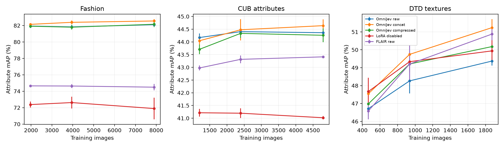

# SuperEmbedding

Reusable attribute memory vectors from OmniJev-0.8B / Qwen3.5-0.8B, trained and evaluated locally on an RTX 5070 Laptop with 8 GB VRAM.

Each image is encoded once under fixed attribute directions. Store normalized 256d **slots**, plus a global vector from concatenation or an optional output projection. Select slots at retrieval time without re-encoding gallery images. New attribute directions require re-encoding. Domains use separate heads.

## Multi-domain results

**28,263 images, three domains, three nested training sizes, three seeds, 432 training runs.** Learning rates and checkpoints were sealed on validation before evaluating 216 selected models on test.

Full-training attribute mAP, mean ± sample SD over three seeds:

| Same-protocol model | Fashion | CUB attributes | DTD textures |
|---|---:|---:|---:|
| OmniJev raw | 82.10 ± 0.21 | 44.36 ± 0.10 | 49.37 ± 0.25 |
| LoRA-disabled base raw | 71.89 ± 1.32 | 41.02 ± 0.06 | 49.94 ± 0.63 |
| Official FLAIR + raw head | 74.50 ± 0.39 | 43.41 ± 0.03 | 50.88 ± 0.35 |

Output projection is **optional and task-dependent**. Under equal joint-loss training, compressed global projection versus concat changes global mAP by **+0.95 pp on Fashion, −0.02 pp on CUB, and −0.98 pp on DTD**. Fashion/CUB compress 768→256d; DTD compresses 256→128d. Attribute slots remain necessary for attribute-selective retrieval. Frozen copied decision gates underperform raw projection in all three domains.

More data clearly helps DTD; Fashion/CUB raw largely plateau at the fixed 1,000-update budget. Most selected models peak at the final update. These are budget-limited, custom image-retrieval comparisons, not optimal-capacity, SOTA, or official classification results. Backbones and compute differ.

[Full results](reports/RESULTS_V3.md) · [Chinese conclusions](reports/CONCLUSIONS_V3.zh.md) · [Projection design](reports/PROJECTION_DESIGN_V3.zh.md) · [Protocol](reports/EXPERIMENT_PROTOCOL_V3.zh.md) · [Model card](MODEL_CARD.md)



## Reproduce and use

Follow [the complete instructions](reports/REPRODUCING_V3.md) and pinned `requirements-local.lock.txt`. After installing upstream models/dependencies:

```powershell
.venv/Scripts/python.exe scripts/restore_research_data.py
.venv/Scripts/python.exe scripts/run_research.py --parallel
.venv/Scripts/python.exe scripts/verify_research_resume.py
.venv/Scripts/python.exe scripts/audit_research.py
.venv/Scripts/python.exe scripts/verify_research_exports.py
.venv/Scripts/python.exe scripts/evaluate_research.py
.venv/Scripts/python.exe scripts/report_research.py
```

Restart the same training command to resume. `last.pt` includes model/optimizer, local/Python/torch/CUDA RNG, step, log accumulators, and input fingerprints. Atomic writes protect the last completed checkpoint. `best_head.pt` loads independently. Exact 2+2-step recovery versus four continuous updates is verified; all 432 heads reproduce saved validation metrics after reload.

```powershell
.venv/Scripts/python.exe scripts/encode_research_image.py --head path/to/best_head.pt --image path/to/image.jpg --output runs/vector.pt
```

The checkpoint selects its OmniJev, base-ablation, or FLAIR backend. Outputs contain `slots` and `embedding`. OmniJev/base single-image inference repeats the image into four independent batch rows to match training's BF16 geometry; batch-1 rounding can otherwise be amplified by the head.

Every trained head and resumable state: [v0.2.0 multi-domain release](https://github.com/bhc6/superembedding/releases/tag/v0.2.0-multidomain). Includes both learning rates and negative results. No source images or upstream backbone weights are bundled. SHA256 manifests accompany all archives.

## Scope, pilot, and attribution

V3 trains heads on frozen backbones. It does not establish causal transfer of decision sensitivity, unseen-composition generalization, arbitrary new-attribute transfer, or novelty. Omni-Attribute lacked usable released code/checkpoints in the inspected repository and is not an empirical baseline. [Source architecture comparison](reports/ARCHITECTURE_COMPARISON.zh.md).

The [v0.1 Fashion2400 pilot](https://github.com/bhc6/superembedding/releases/tag/v0.1.0-fashion2400) remains available with [results](reports/FORMAL_RESULTS_TABLE.md), [model card](reports/MODEL_CARD_PILOT_V01.md), and [original workflow](reports/README_PILOT_V01.md). Its 100-update real-image LoRA follow-up did not improve validation; selected step-0 and actual step-100 models remain published. V3 includes no new end-to-end LoRA experiment.

Code and contributed head parameters: Apache-2.0, with upstream attribution in [NOTICE](NOTICE). Dataset restrictions still apply: CUB is for non-commercial research/education; DTD is provided for research. We do not assert commercial-use clearance. See [data sources and terms](sources/research_datasets_v3.json).
