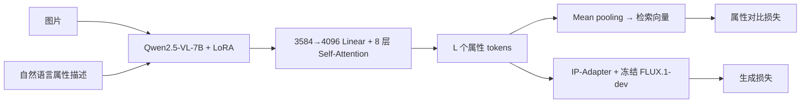
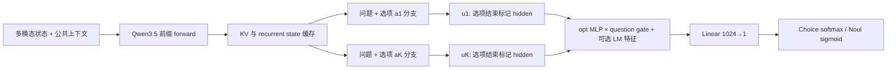

# 属性条件化多模态 embedding：源码与效果比较

核对日期：2026-10-10。工作目录：`D:\DEMO\superembedding`。

本报告区分三种证据：**代码确认**、**论文报告**、**待实验的方案推断**。本轮没有运行模型，不将作者数字表述为本地复现结果。所有仓库版本见 [repositories.json](../sources/repositories.json)。

## 1. 直接结论

OmniJev 已经产生“每个选项一个条件化隐藏向量”，因此用户提出的改造有明确落点：从 `branch_forward` 返回的 `u` 出发训练多维 projection，或从现有 head 的 1024 维门控表示出发训练 projection。但这些隐藏向量目前接受的是决策监督，不等于已经有好的检索距离。

Omni-Attribute 最值得借鉴的是**属性训练数据与损失**；FLAIR 最适合参照**自然语言 query 对视觉 tokens 的 cross-attention**；BoQ 最适合参照**多 query 聚合成一个可索引向量**。这三种机制与 OmniJev 分支的组合，是可实施的实验路线，不能仅凭组合断言创新成立。

两个修正必须保留：

1. Omni-Attribute 官方 GitHub 当前是网页仓库，没有模型训练/推理实现；这里的模型细节来自论文 §3、附录 A。
2. OmniJev v1.1 三个公开尺寸的 `head_meta.json` 都是 `norm=softmax, lm_feats=true, ordinal=true, branch=true, rlcd=false`。`head.py` 开头关于旧版独立 sigmoid 的注释不能代表当前 Choice checkpoint。

## 2. 实际取得的代码与来源

| 项目 | 本地目录 | 当前公开内容 | 证据等级 |
|---|---|---|---|
| [Omni-Attribute](https://github.com/snap-research/omni-attribute) | `repos/Omni-Attribute` | HTML/CSS/JS 项目网页；模型源码未找到 | 论文 + 网页树核对 |
| [OmniJev](https://github.com/tinnel123666888/OmniJev) | `repos/OmniJev` | 分支、head、推理、评测审计；当前树无完整训练入口 | 代码 + v1.1 配置 |
| [FLAIR](https://github.com/ExplainableML/flair) | `repos/FLAIR` | backbone、pooler、loss、训练与推理示例 | 代码 + 论文 |
| [AG-MAN](https://github.com/Dr-LingXiao/AG-MAN) | `repos/AG-MAN` | ResNet、属性注意力、训练与检索 | 代码 + 论文 |
| [Bag-of-Queries](https://github.com/amaralibey/Bag-of-Queries) | `repos/Bag-of-Queries` | 多 query 聚合、backbone、metric training | 代码 + 论文 |

另保留 [MM-slotgate](https://arxiv.org/abs/2608.12570)、[FRAME](https://arxiv.org/abs/2609.08886) 的论文。官方论文没有提供可确认的实现链接，本轮检索未找到对应官方代码，因此没有拿名字相近的无关仓库替代。

## 3. 总体结构比较

| 方法 | Backbone | 属性/选项从哪里进入 | 输出 | 主要训练信号 | 提前编码条件 |
|---|---|---|---|---|---|
| Omni-Attribute | Qwen2.5-VL-7B | 图片与自然语言属性一起输入 MLLM | `L × 4096` attribute tokens；均值池化为 4096 维 | 属性对比 + 图像生成 | 固定属性可预编码；新属性通常要重跑 encoder |
| OmniJev v1.1 | Qwen3.5-0.8B/2B/4B | 共享前缀后，选项进入独立 backbone 分支 | 每选项隐藏向量 → 概率；Score 用 ordinal head | 决策概率监督，另做校准 | 原始接口依赖问题/选项；改用固定方向后可缓存 |
| FLAIR | ViT-B/16 + 文本 Transformer | 文本向量作 Q，视觉 tokens 作 K/V | 每个文本条件一个 512 维视觉向量 | 条件 sigmoid 对比 + 多正例全局对比 | 可先缓存视觉 tokens；任意新文本仍需条件 pooling |
| AG-MAN | ResNet-50 特征融合 | 固定属性 ID embedding 控制空间/通道注意力 | 当前 `model.py` 返回 512 维向量 | 属性条件 triplet ranking + 辅助分类 | 已知固定属性可预编码 |
| BoQ | ResNet / DINOv2 变体 | 学习到的 queries，无语言属性标签 | 多 query 读出 → 行维投影 → flatten | MultiSimilarity loss + mining | 原生支持固定全局向量预编码 |
| MM-slotgate | 预计算 Fashion-CLIP ViT-B/32 图文向量 | 四个固定 slot 的独立投影与图文 gate | `4 × 128` 连续向量 | 属性 CE + VQ commitment + 正交约束 | 四个 slot 可预编码；查询时加权 |
| FRAME | SigLIP-so400m；可加 BGE caption | 每属性一个 MLP probe；查询解析成属性权重 | 47 个属性标量概率 | 每属性加权 BCE | 可缓存全部属性证据，再矩阵乘查询权重 |

注意：Omni-Attribute 的 L 个 tokens 是一个属性条件下的表征序列，**不是 L 个独立语义属性 slot**。FLAIR 的多个文本条件也不自动等于多个 attention heads。

## 4. Omni-Attribute：属性信息在整个 MLLM 中被条件化

依据：[论文](https://arxiv.org/abs/2512.10955) §3.2–3.4、A.3–A.4；本地 [HTML](https://arxiv.org/html/2512.10955)。



- MLLM hidden size 3584；视觉 encoder 与 MLLM 线性层加入 LoRA，论文配置 rank 256、alpha 512。
- connector 是线性升维加八层 self-attention，不是“每个属性对应一个线性 head”。
- 训练期有 FLUX.1-dev、IP-Adapter；检索只使用属性 encoder 与池化，不需要生成图片。
- 两张图的共享属性是正属性，不同的属性是负属性。对比目标同时压制不相关属性与属性值差异带来的混淆。
- 先用生成目标训练 100K steps，再联合对比目标训练 10K steps。论文报告 64 张 80GB H100、batch 256。完整复现成本显著高于单独训练 projection。

**效果中最有说服力的是属性敏感性消融。** 论文 Table 1：同为 LoRA + 八层 connector，无对比损失时正负属性 cosine gap 为 **−0.002**；最终联合设置为 **0.608**。对应生成属性保真度从 0.651 到 0.641，说明“属性可区分性”与“生成保真度”是不同目标。

这里的 gap 是 1K 验证图对上的正负属性相似度差，**不是检索 R@1/mAP**。CelebA 约 17.7K 图片上的检索主要展示案例，未给出足以与其他检索模型统一排名的定量表。

## 5. OmniJev：选项向量已经存在，但距离几何尚未被训练

代码：[branch.py](https://github.com/tinnel123666888/OmniJev/blob/14dbec4f71e194852c8d7b88ab36ef639493f400/mso/branch.py#L128)、[head.py](https://github.com/tinnel123666888/OmniJev/blob/14dbec4f71e194852c8d7b88ab36ef639493f400/mso/head.py#L40)、[infer.py](https://github.com/tinnel123666888/OmniJev/blob/14dbec4f71e194852c8d7b88ab36ef639493f400/mso/infer.py#L333)。



### 5.1 Backbone 配置不是同一种 Transformer

下表来自官方 HF `config.json` 的本地快照；层数分别指语言部分和视觉部分。

| Backbone | 语言 hidden | 语言层数 | 语言注意力 | 视觉 depth / hidden | 视觉 patch / merge |
|---|---:|---:|---|---|---|
| Qwen2.5-VL-7B | 3584 | 28 | 标准 softmax 自注意力，GQA 28 Q / 4 KV heads | 32 / 1280 | 14 / 2 |
| Qwen3.5-0.8B | 1024 | 24 | 18 linear + 6 full-attention 层 | 12 / 768 | 16 / 2 |
| Qwen3.5-2B | 2048 | 24 | 18 linear + 6 full-attention 层 | 24 / 1024 | 16 / 2 |
| Qwen3.5-4B | 2560 | 32 | 24 linear + 8 full-attention 层 | 24 / 1024 | 16 / 2 |

Qwen3.5 每四层一层 full attention。其余 linear-attention 层有 recurrent state，因此仅靠 block-diagonal attention mask 无法可靠隔离串在一起的选项。OmniJev 的解决方式是复制共享前缀状态，再按 batch 行分别运行选项后缀；这不是额外添加一层 cross-attention pooler。

LoRA checkpoint 配置：三个尺寸均 rank 32、alpha 64、dropout 0.05；target modules 包括普通 attention 的 q/k/v/o、MLP 的 gate/up/down，以及 hybrid 层的 `in_proj_qkv`、`in_proj_z`、`out_proj`。公开代码可核对加载与推理；完整训练循环、数据配比及每项 loss 系数不能由当前仓库独立复原。

### 5.2 当前 head 的精确路径

设 D 为 backbone hidden size。`branch_forward` 读取选项结束标记得到 `u_i ∈ R^D`，读取选项开始前的标记得到问题表示 `z_q ∈ R^D`。

```text
opt(u_i): Linear(D,1024) → GELU → Linear(1024,1024)
que(z_q): Linear(D,1024) → GELU → Linear(1024,1024)
g = tanh(que(z_q))
h_i = opt(u_i) * g + feat(lm_features_i)   # feat 路径可选
logit_i = score(h_i) + feat_lin(lm_features_i)
```

当前 v1.1：Choice 在 K 个选项及 abstain 上 softmax；Noul 使用 sigmoid；启用的 Score 路径用独立 ordinal head，hidden 512，利用递增阈值构造有序概率。

三个尺寸的 `head_meta.json` 均启用 LM 特征。六个特征包括候选文本 log-prob 总和、均值、长度、候选组内 log-softmax、首 token log-prob、有效性标记。

**复用时的关键细节：** [branch.py:216](https://github.com/tinnel123666888/OmniJev/blob/14dbec4f71e194852c8d7b88ab36ef639493f400/mso/branch.py#L216) 的组内 log-softmax 使 `feats[:,3]` 随候选集合变化。分支隐藏向量隔离，并不等于最终 head 表示与概率都对候选集合不变。若新 embedding 从 `h_i` 读取，要移除或替换该特征，或固定整个属性词典；是否造成实际数值变化还取决于已训练权重，本轮没有加载权重测量。

OmniJev 的视频主要通过帧拼图输入，音频通过声谱图/波形图表达，多图通过编号面板输入。不能把它描述为拥有独立原生音频 encoder 的统一音视频模型。

### 5.3 哪些读出值得对照

| 读出候选 | 表示维度 | 继承什么 | 必须补充什么 |
|---|---:|---|---|
| `normalize(u_i)` | D | 选项条件化 backbone 表示 | 验证原始 cosine 是否有意义 |
| `normalize(P(u_i))` | d | 同上，可压缩 | 属性对比/检索训练 |
| `normalize(P(opt(u_i) * tanh(que(z_q))))` | d | 现有 decision head 的门控变换 | 新距离目标；与直接投影公平比较 |
| 从视觉/多模态 tokens 做语言条件 attention pooling | d | 类 FLAIR 的显式证据读出 | 新模块训练；这是另一种架构，并非仅替换标量层 |

原决策训练只约束最终标量或概率。保持标量正确并不能唯一确定多维空间的距离，因而不能宣称“把最后一层换宽就自动得到强 embedding”。

## 6. FLAIR、BoQ、AG-MAN 的代码对照

### FLAIR：语言作为真正的 attention query

源码：[model.py:458](https://github.com/ExplainableML/flair/blob/0f9ce05886d1ee0aa2c628653104cce77a1fff14/src/flair/model.py#L458)、[transformer.py:226](https://github.com/ExplainableML/flair/blob/0f9ce05886d1ee0aa2c628653104cce77a1fff14/src/flair/transformer.py#L226)、[loss.py:224](https://github.com/ExplainableML/flair/blob/0f9ce05886d1ee0aa2c628653104cce77a1fff14/src/flair/loss.py#L224)。

- 配置为 ViT-B/16：图像 224，视觉 12 层、width 768；文本 12 层、width 512、8 heads、上下文 77；最终 embedding 512。
- 图像与文本先分别编码并投影；`visual_proj(global_text_token, local_image_tokens, local_image_tokens)` 明确指定 Q=text、K/V=image。
- pooler 使用 8-head MultiheadAttention，Q/K/V 分别 LayerNorm；没有用“文本 residual 直接加输出”替代视觉读取。
- 训练同时涉及条件 sigmoid contrastive loss 与可选 multi-positive global sigmoid loss；完整论文设置还有多 caption、diverse sampling。
- 原方法的条件视觉向量依赖当前文本。固定 K 个属性提示可以扩展成可缓存 slot bank，但这是为我们的目标所作的适配，不是原论文已经验证的 memory 接口。

### BoQ：多 query → 多向量 → 全局检索向量

源码：[boq.py](https://github.com/amaralibey/Bag-of-Queries/blob/1a4965ea7dfd9bd0dd846adf7a0e430f68101d12/src/boq.py#L11)、[model.py](https://github.com/amaralibey/Bag-of-Queries/blob/1a4965ea7dfd9bd0dd846adf7a0e430f68101d12/src/model.py#L38)。

每个 block 先更新视觉 tokens；学习到的 queries 做 query self-attention，再 cross-attend 视觉 tokens。多个 block 的读出沿 query 轴拼接，`Linear(num_layers * num_queries, row_dim)` 压缩/混合 query 轴，最后 flatten 和 L2 normalize。

因此它并非永远直接保存 K 个独立可解释 slot：最终 row projection 会混合不同 queries。代码默认 `proj_channels=512, row_dim=32` 对应 **16384 维**；论文还有 **4096 维**设置，不能混用默认配置与论文某一行的维度。

监督是 MultiSimilarity loss 和 hard pair mining，语义标签为地点身份。它证明多 query 聚合在地点检索上有价值，不证明 queries 自动对齐颜色、材质等语言属性。

### AG-MAN：固定属性控制空间与通道

源码：[model.py:69](https://github.com/Dr-LingXiao/AG-MAN/blob/11d3e89b10cadb6cc52c16c97cee1cd4ec8f4d3b/model.py#L69)、[resnet.py:134](https://github.com/Dr-LingXiao/AG-MAN/blob/11d3e89b10cadb6cc52c16c97cee1cd4ec8f4d3b/resnet.py#L134)、[mainFashionAI.py:73](https://github.com/Dr-LingXiao/AG-MAN/blob/11d3e89b10cadb6cc52c16c97cee1cd4ec8f4d3b/mainFashionAI.py#L73)。

固定属性 ID → 512 维 learned embedding；ResNet 中间特征融合后，通过属性空间注意力 ASA、空间注意力、属性通道注意力 ACA 与可学习 mask 得到条件向量，最后 L2 normalize。训练循环把 margin ranking 的 triplet loss 与辅助分类 loss 用 AutomaticWeightedLoss 组合。

代码审查发现 `--dim_embed` 默认写 1024，但当前 `model.py` 的卷积、属性 embedding、channel mask 均硬编码 512，`embedding_size` 仅存储而未决定输出。因此报告当前代码输出为 **512 维**，不是照抄 CLI 默认值。仓库较旧，存在硬编码 14×14 特征图和本地 ResNet 权重文件等运行前提，本轮未测试可直接运行性。

## 7. 效果：分任务比较，不跨指标排总榜

以下均为作者报告。

| 工作与比较 | 数据/任务 | 指标与结果 | 可以支持的判断 |
|---|---|---|---|
| Omni-Attribute，无对比 → 最终联合训练 | 1K 验证图对 | 属性 cosine gap −0.002 → 0.608 | 属性判别监督显著影响条件敏感性；非检索准确率 |
| FLAIR，global-only → text-conditioning-only → 完整设置 | CC3M-recap 训练，COCO 检索 | T2I R@1 28.3 → 32.0 → 37.7；I2T 40.1 → 45.6 → 51.6 | 条件化本身有效；完整增益还包含其他组件 |
| BoQ vs MixVPR，同 ResNet-50 / GSV-Cities / 4096 维 | 地点检索 | MSLS R@1 91.1 vs 88.0；论文 Table 2 Nordland 69.5 vs 58.4 | 多 query 聚合有明确受控基线 |
| AG-MAN | FashionAI / DeepFashion / Zappos50k | mAP 62.8788% / 8.9804%；triplet prediction accuracy 93.32% | 支持封闭属性服饰检索；不同数据指标不能互比 |
| MM-slotgate，固定等权 slot gate → learned gate | H&M 5K held-out gallery | macro CS@10 0.7516 → 0.7566 | gate 学习仅增 0.5 个百分点，主要收益不能全归因于 gate |
| FRAME，CrossEncoder → FRAME-Vis | 26 个 HSSD 测试场景，3720 query-scene pairs | P@1 62.58% → 77.82% | 固定属性分解与训练读出在该协议有效 |

FLAIR/BoQ 数字来自论文 ablation/controlled comparisons。BoQ 的 Nordland 有不同设置，这里固定引用 Table 2，不能与其他表的 Nordland 行直接混合。

MM-slotgate 的检索同时使用 slot 加权拼接 cosine 和属性 logit 分数，不能将 CS@10 全视为纯向量效果。其正文写 text-only 0.4755，但 Tables 1/2/4 写 0.4765；若引用该基线，采用表格 0.4765 并保留此不一致。FRAME 每属性输出标量，不是每属性一个多维 embedding；其约 0.01ms 是解析完查询后的缓存矩阵评分，含 LLM 查询解析的总延迟约 1.638s。

### OmniJev 的效果只能说明决策任务表现

依据：[逐数据集审计](https://github.com/tinnel123666888/OmniJev/blob/14dbec4f71e194852c8d7b88ab36ef639493f400/docs/dataset_scores_v11.md#L1)。

| 已有预测的项目任务 | 0.8B | 2B | 4B | 评测口径 |
|---|---:|---:|---:|---|
| A-OKVQA 有效多选题 | 56.67% | 68.40% | 77.07% | 各 750 题，自定义候选/abstention 协议 |
| ESC-50 声谱图转化任务 | 51.07% | 42.01% | 53.08% | 各 795 题，非标准原生音频模型比较 |
| AndroidControl 转化任务 | 71.70% | 71.84% | 77.30% | 各 1502 题，项目协议 |

旧 A-OKVQA 混合行含无效 yes/no 标签已撤回；旧总体 macro/micro 也混入该数据，不拿旧总分当有效结论。Base/SFT 与 decision 模型的样本、输入多图路径及训练预算不一致。OK-VQA 的 93.47% 是给定包含正确答案的候选选择，并非开放式 VQA 分数。没有公开属性检索实验可以证明 OmniJev hidden vectors 优于 FLAIR 或 Omni-Attribute。

## 8. 对 superembedding 的具体架构建议（尚未实现或验证）

先做最小可归因版本：保留 OmniJev 的独立选项分支，使用一个共享 projection 对每个 `u_i` 输出 d 维向量；方向采用固定、版本化的自然语言属性词典。这里的“问题”是固定编码指令，“多模态对象”是被写入记忆的内容，不输入未来用户查询。

```text
对象 x + 固定编码指令 c
  → 共享 prefix cache
  → K 个独立属性分支 a_i
  → u_i
  → 共享 P + 单 slot L2 normalize
  → Z(x) = [z_1, ..., z_K]，形状 K × d
  → 按需拼接为全局 ANN 向量，保留 slot 边界
```

为什么优先共享 projection：不同方向可由自然语言分支控制，避免把每个方向完全写死为一个独立 P_i；但能否泛化到未见属性仍需实验。

固定 K 与顺序时可存 `concat(z_1,…,z_K)/sqrt(K)`。查询属性权重非负时，保留原始 slot bank 更灵活：`score = sum_i w_i * dot(q_i,z_i)`。若两侧都加权拼接，要使用 `sqrt(w_i)` 才对应线性权重和，而不是误得 `w_i^2`。若只给查询侧加权，点积可对应该加权和；实际 cosine 的归一化、缺失 slot 和 ANN 索引策略仍需一致约定。

新增属性不等于对原固定向量免费扩维：通常仍要对旧对象编码该新属性。使用 BoQ 式混合投影虽可压缩，但会牺牲直接选择语义 slot 的便利，应单独比较。

**必要对照与要回答的问题：**

| 对照 | 要隔离的贡献 |
|---|---|
| 原始 Qwen3.5 + 相同分支/projection/数据 vs OmniJev 初始化 + 相同设置 | 决策训练是否真的改善属性检索 |
| raw `u_i` vs projection vs gated head 表示 | 表示落点与 metric training 的作用 |
| 单向量 vs 多 slot，匹配总维度/存储 | 改进是否仅来自容量增大 |
| FLAIR 条件池化与 BoQ 学习 queries，尽量匹配 backbone/预算 | 自然语言方向、查询聚合、决策初始化各自贡献 |
| 属性正负对比 vs 普通实例对比 | 是否学到目标属性而非对象身份 |
| 未见属性值、未见组合、未见方向、关键属性干预 | 泛化与关键证据敏感性是否保留 |

Omni-Attribute 的生成目标可以作为额外对照，但不必一开始就引入 FLUX。先以属性对比目标证明检索几何，再判断生成监督是否值得其成本。固定预算下比较 Recall@K/mAP、目标属性满足率、干扰属性泄漏、写入成本、每对象存储与查询延迟。

研究主张应是可检验的问题：“决策适配产生的条件化表示，在相同 backbone、属性监督与向量预算下，是否比从原始 VLM 出发更能保留关键证据？”不能仅以“decision head 改 embedding head”作为已经确认的新颖性。

## 9. 可复查证据入口

- [Omni-Attribute 论文](https://arxiv.org/abs/2512.10955)：§3、§4.3–4.4、A.3–A.4。
- [FLAIR 论文](https://arxiv.org/abs/2412.03561)：Table 5；代码链接见 §6。
- [BoQ 论文](https://arxiv.org/abs/2405.07364)：Table 2、5、7。
- [AG-MAN 论文](https://arxiv.org/abs/2301.13014)；代码链接见 §6。
- [Promptable Embeddings](https://arxiv.org/abs/2505.15877)：属性提示与预计算方向的先例。
- [MM-slotgate 论文](https://arxiv.org/abs/2608.12570)：§3、Tables 1–4。
- [FRAME 论文](https://arxiv.org/abs/2609.08886)：§4、Table 3、Appendix A。
- [OmniJev v1.1 head metadata](https://huggingface.co/tinnel123/OmniJev/blob/v1.1/head_meta.json)、[adapter metadata](https://huggingface.co/tinnel123/OmniJev/blob/v1.1/adapter_config.json)。对应三种尺寸的 JSON 已保存至 `sources/`。
- [Qwen2.5-VL-7B 配置](https://huggingface.co/Qwen/Qwen2.5-VL-7B-Instruct/blob/main/config.json)、[Qwen3.5-4B 配置](https://huggingface.co/Qwen/Qwen3.5-4B/blob/main/config.json)；三个 Qwen3.5 尺寸均已保存本地快照。
