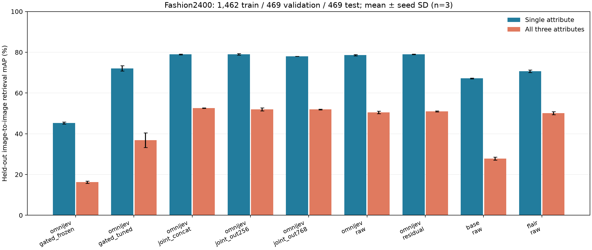

# SuperEmbedding

Reusable attribute memory vectors from OmniJev-0.8B / Qwen3.5-0.8B. This is a research prototype for fixed-direction image-to-image retrieval, with real local training on an RTX 5070 Laptop (8 GB).

Each image is encoded once under an ordered attribute basis. The head returns normalized **slots** (one 256d vector per attribute) and a **global embedding** (concatenation, or a learned output projection). Queries choose a slot or a subset of slots without re-encoding the image. Unseen attribute directions require encoding a new basis.

Architectures: raw hidden projection, frozen/trained OmniJev multiplicative gates, a raw residual around the gate, and concatenation with/without a 768d or 256d output projection. See [design](../reports/OUTPUT_PROJECTION_DESIGN.zh.md), [frozen protocol](../reports/EXPERIMENT_PROTOCOL_V2.zh.md), and [architecture audit](../reports/ARCHITECTURE_COMPARISON.zh.md).

## Measured results

On Fashion2400, three-seed three-attribute mAP is **52.60±0.09%** for direct concatenation with joint supervision, **51.93±0.20%** with a 768d output projection, and **51.97±0.79%** with a 256d projection. Output projection is optional here; the smaller vector is a compression tradeoff. Raw projection outperforms the copied multiplicative gate. These are local task results, not a claim of state of the art.

See the [complete results](../reports/FORMAL_RESULTS_TABLE.md), [interpretation in Chinese](../reports/FORMAL_CONCLUSIONS.zh.md), and [model card](MODEL_CARD_PILOT_V01.md).

Weights and resumable training states: [Fashion2400 release](https://github.com/bhc6/superembedding/releases/tag/v0.1.0-fashion2400). All 54 trained heads are included, including negative results. The LoRA follow-up did not beat its starting validation score; both the selected step0 model and actual final step100 model are clearly labeled.



## Reproduce

Python 3.13 was used. PowerShell commands, from this repository:

```powershell
python -m venv .venv
.venv\Scripts\python -m pip install torch==2.10.0 torchvision==0.25.0 --index-url https://download.pytorch.org/whl/cu128
.venv\Scripts\python -m pip install -r requirements-local.txt
.venv\Scripts\python scripts/clone_dependencies.py
.venv\Scripts\python scripts/download_models.py
.venv\Scripts\python scripts/prepare_fashion.py
.venv\Scripts\python scripts/prepare_formal.py
.venv\Scripts\python scripts/extract_features.py --data data/fashion2400 --output runs/fashion2400/omnijev
.venv\Scripts\python scripts/run_matrix.py
.venv\Scripts\python scripts/evaluate_lora.py
.venv\Scripts\python scripts/summarize_results.py
.venv\Scripts\python -m pytest -q
```

Windows uses `MSO_FLA=0` (PyTorch fallback), set by the scripts. Keep Transformers at 5.5.0: 5.3.0 failed the real Qwen3.5 cache path. Exact installed dependencies are in `requirements-local.lock.txt`; CUDA wheels require the PyTorch index above.

The first 600 images are development-only. The formal 2,400-image subset excludes those products and exact/dHash near duplicates. It contains 1,462 train / 469 validation / 469 test images, three catalog attributes and 40 joint strata. Split metadata and recorded results are published under `artifacts/`. Source product images are not redistributed.

## Checkpoints and resume

`experiment_suite.py` automatically resumes `last.pt`, including optimizer, completed step, sampling RNG, CPU/CUDA RNG and configuration/data/feature fingerprints. It keeps the best validation head and snapshots at steps 250 and 500. `train_lora.py` also resumes automatically and stores trainable backbone parameters plus the head, validating the original model/head identity. An interrupted update is replayed from the last saved completed update. Both use atomic temporary-file replacement.

Use `--stop-after N` to test a graceful interruption, then rerun the same command without that flag. Do not change training/data settings in an existing run directory. Frozen-cache training is the primary multi-seed comparison; 100-step real-image LoRA is a separate one-seed follow-up. Original development results remain for provenance.

## Encode a new image

Download a published **OmniJev** head from the release; retain its fixed attribute order. For a head trained on frozen OmniJev features:

```powershell
.venv\Scripts\python scripts/encode_image.py --image path/to/product.jpg --head path/to/best_head.pt --adapter models/OmniJev-0.8B-v1.1 --base models/Qwen3.5-0.8B --output runs/vector.pt
```

For fine-tuned LoRA, set `--adapter` to the released derived adapter directory and `--head` to its `embedding_head.pt`. Base-ablation and FLAIR heads require their respective extractors; they are not interchangeable with the OmniJev encoder.

## Scope and attribution

FLAIR is directly measured on the same local fixed-direction retrieval protocol, frozen and with an equal-budget supervised head. This is not a reproduction of its original text-to-image benchmark. Omni-Attribute had no usable public checkpoint/code in the inspected repository and is not presented as an empirical baseline.

This small fashion task does not establish novelty, open-domain memory quality, unseen-composition generalization, or transfer of causal decision evidence. All values/combinations are seen in training; dHash filtering is heuristic. Models may have unknown pretraining overlap with product images. Negative results are retained.

Code and our derived models: Apache-2.0; attribution in [NOTICE](../NOTICE). Original base weights and external models retain their upstream licenses and are downloaded at fixed revisions. Inherited OmniJev decision heads are not recalibrated or validated after LoRA updates.
